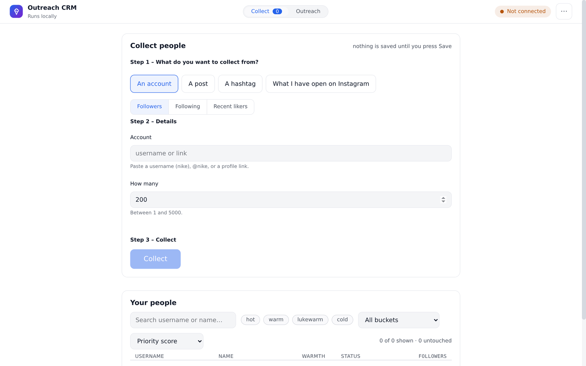
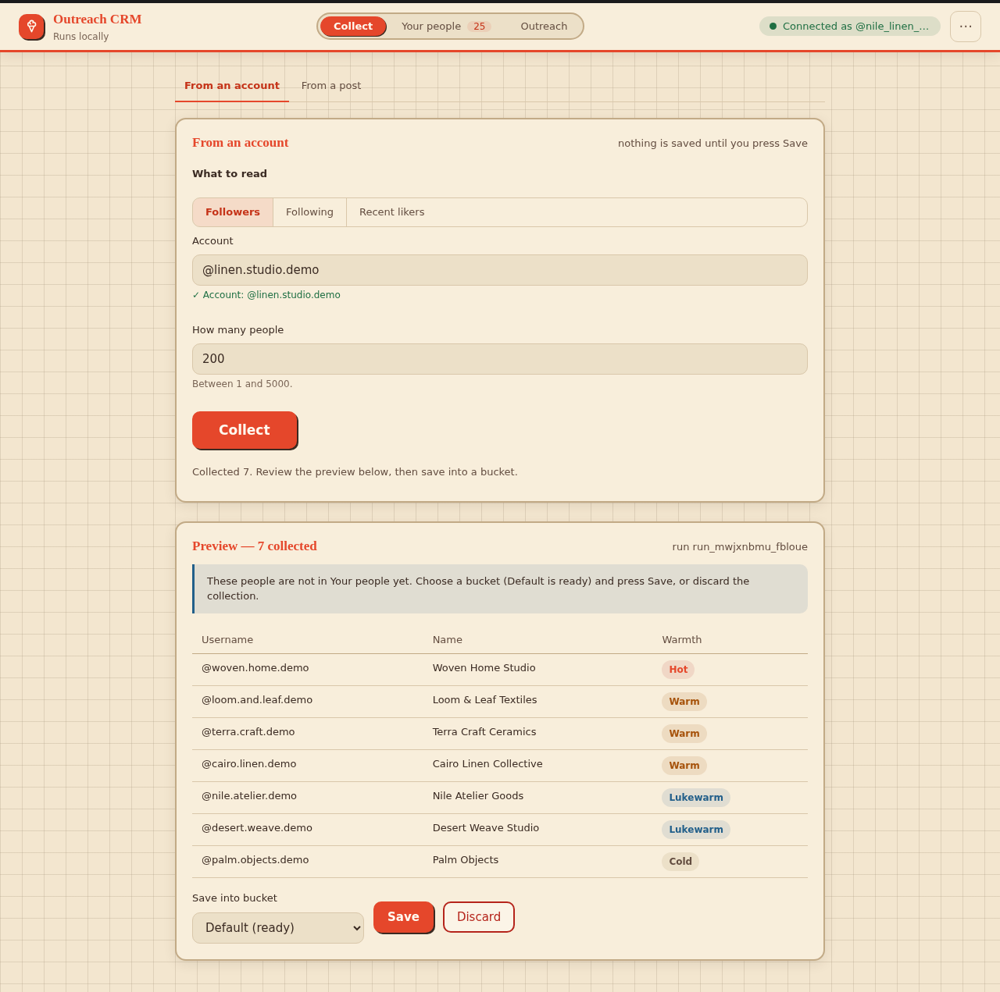
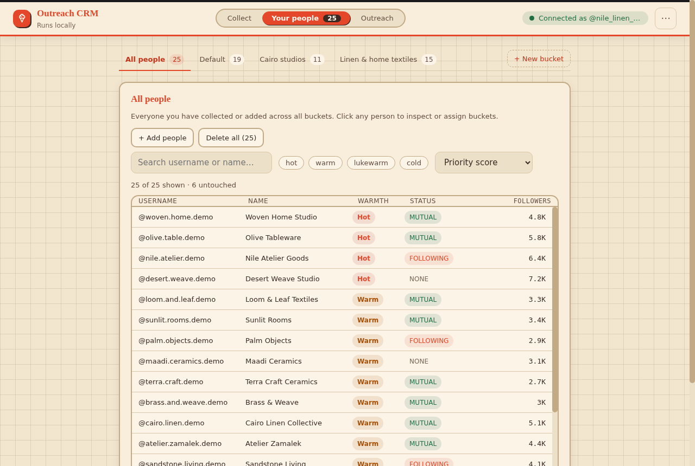
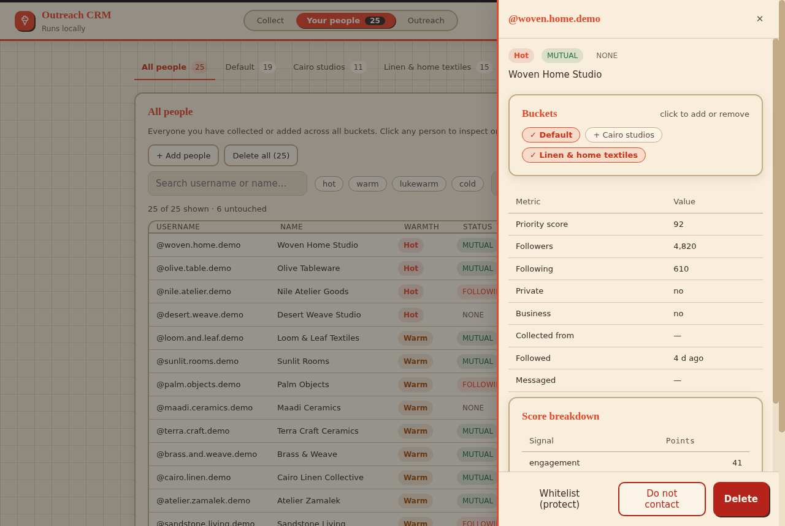
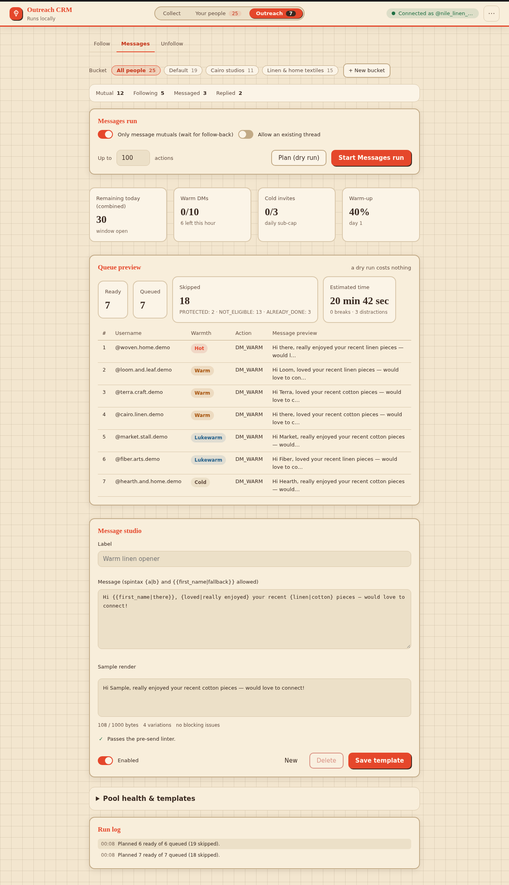
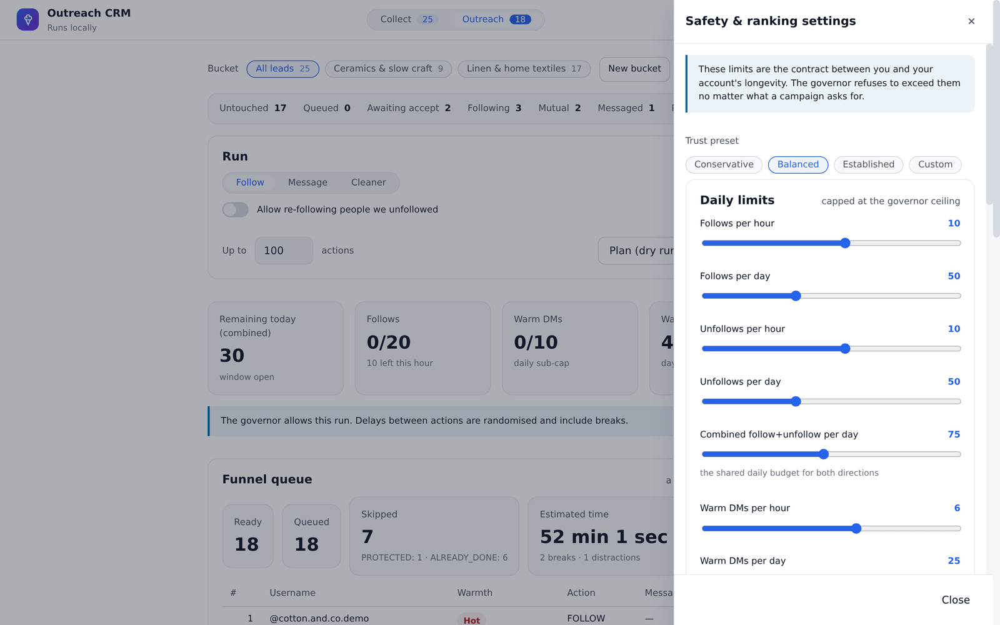
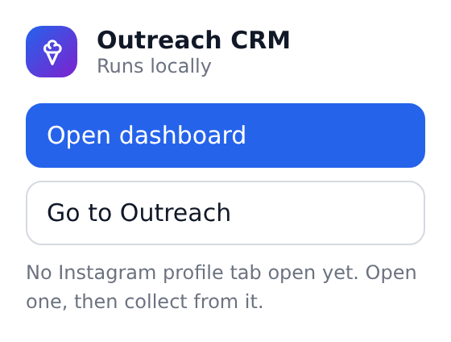

# IG Outreach CRM

**A free, local Chrome extension that collects warm Instagram leads visibly inside your browser tab and runs a human-paced follow, accept-detect, and DM workflow from your own logged-in session.**

> **Download page:** [https://ahmed-sleem.github.io/ig-outreach-crm/](https://ahmed-sleem.github.io/ig-outreach-crm/)

   

## Why

Messaging strangers cold is how Instagram accounts get restricted. The people worth talking to are already visible: they comment on your competitors' posts, they like the same three accounts in your niche, they follow the shop two streets over. Finding them by hand means scrolling for hours and keeping a spreadsheet that is stale by the time you finish it.

This extension handles collecting, organising, and pacing across three clean tabs — **Collect**, **Your people**, and **Outreach** — each organised with focused sub-tabs. **Collect** drives your visible Instagram tab like a real person (smooth curved cursor movement, real clicks, human-paced dialog scrolling — zero forged Instagram API requests), previews the people it found, and saves them into your ready **Default** bucket or any custom bucket you create. **Your people** gives every bucket its own tab with a virtualised table, warmth filters, manual **+ Add people**, **Delete all** (for a bucket or the whole workspace), and one-click bucket assignment. **Outreach** separates **Follow**, **Messages**, and **Unfollow** into dedicated sub-tabs running inside strict daily limits and an optional active-hours window.

There is no server, no API key, no subscription, and no account. Everything is stored locally in IndexedDB on your machine and can be exported in full at any time.

## Why this approach works (and what we tried that didn't)

Building reliable Instagram tooling in 2026 meant testing several common approaches against live desktop Instagram, seeing where each one breaks, and keeping only what holds up in a real Chrome session.

### Why visible, in-tab human DOM execution is the best approach

- **Zero private API calls:** Instagram's own React app issues every network request with real page focus, browser TLS fingerprint, scroll telemetry, and genuine DOM interaction. The extension never calls `/api/v1/` or GraphQL endpoints directly — it clicks real buttons, scrolls real modals, and verifies outcomes directly off the rendered UI.
- **Single foreground tab + instant return:** One normal Instagram tab handles the work cleanly (no parallel tabs racing the same session), shows a compact closed-Shadow-DOM HUD with live progress and an instant **Stop** button, and returns focus to the dashboard when done.
- **Strict safety governor in code:** Hourly/daily ceilings, log-normal delays with natural distractions and breaks, duplicate-DM prevention, and a persisted circuit breaker on real Instagram action blocks are enforced in pure tested code that the UI cannot exceed.
- **No MV3 service worker:** Chrome terminates idle service workers mid-run and can fail to register them on busy profiles. Running orchestration from the extension's own dashboard tab over a `chrome.storage.local` mailbox keeps multi-hour runs reliable and survivable across page navigations.

### Approaches we tried that did not work (and why we replaced them)

| What we tried | Why it failed on 2026 Instagram | What we do instead |
|---|---|---|
| **Direct `/api/v1/` & GraphQL `fetch()` scraping** | Triggered `401`/`429` responses, rotating header checks (`x-ig-app-id` / `x-asbd-id`), and rapid checkpoints because requests lacked real page telemetry and pointer history. | 100% browser-DOM collection and real-UI clicking/typing inside your visible tab. |
| **Background / hidden tabs** | Chrome throttles timers and `IntersectionObserver` callbacks in hidden tabs, so Instagram's virtualised Followers/Following/Likes modals stall and stop loading new rows. | Bring one normal Instagram tab to the foreground during a run, then switch focus back to the dashboard automatically. |
| **Naive `chrome.tabs.sendMessage` + service worker** | Promises hang silently whenever Instagram navigates or reloads mid-action, and MV3 kills idle workers during long outreach waits. | Persistent `chrome.storage.local` mailbox with `storage.onChanged` wake-up, per-command reply keys, `targetTabId` multi-tab routing, and concurrent mid-run `STOP`. |
| **Raw `textContent` & hardcoded CSS classes** | 2026 Instagram randomises class names and puts `<svg><title>Down chevron icon</title></svg>` inside `"Following"` buttons (`"FollowingDown chevron icon"`), hides icon-only `"Send"` buttons behind `aria-label`, and uses `/<user>/p/<code>/` URLs. | Strip SVG/title subtrees for button matching, check `aria-label` on icon buttons, scope relationship checks to profile `<header>`, and recognise profile-prefixed post URLs. |
| **Clicking the first `followers` link or scrolling the first `overflow` div** | 2026 profiles render a trap link `<a href=".../followers/mutualOnly">Followed by …</a>` above the real modal, wrap Followers in a decoy `height:auto` div, append a second `"Suggested for you"` scroller inside Following, and stack Likes modals on top of Post modals. | Explicitly skip `mutualOnly`, pick the deepest scrollable container holding real user links before `"Suggested for you"`, and match modal headings strictly so Post modals are never mistaken for Likes/Followers. |
| **Checking `[role="article"]` / generic `[role="row"]` in Direct DMs** | 2026 Comet Direct renders threads in `[role="grid"] [role="row"]` — and puts a `"View profile"` intro card and encryption banner inside empty new threads (which looked like an existing conversation). | Support Comet `[role="grid"] [role="row"]` while filtering out `"View profile"` cards, timestamps, and system notices, and verify the open thread actually matches the target handle before sending. |
| **Blocking single-command loop & unified Stop handling** | Awaiting a long collection blocked Dashboard `STOP` until timeout, and treating owner-initiated Stop the same as a platform refusal tripped the 48-hour circuit breaker. | Run long commands asynchronously while control commands (`STOP`/`PING`) execute immediately, and cleanly separate owner stops (`STOPPED`) from real Instagram action blocks. |

## What it is / what it is not

- **It acts visibly in your browser.** Both collecting and outreach (follow, message, unfollow) run through Instagram's own rendered UI in a visible tab with smooth cursor movement and natural scroll pacing — never through direct `/api/v1/` or forged write requests, and never in parallel tabs.
- **It is not a bulk tool.** Every ceiling in `src/core/governor.js` is clamped in code below the levels that get accounts blocked, and the UI cannot raise a value past its floor. Defaults assume an account you care about keeping.
- **It is not undetectable.** Nothing that runs inside a real session at machine rhythm is. The pacing exists to stay inside the envelope a person produces, not to be invisible.
- **It does not scrape what Instagram withholds.** Liker lists stop at roughly 100 per post, third-party follower lists are server-capped, and hidden counts stay hidden. The app reports the truncation instead of guessing around it.
- **Your account, your responsibility.** Automated following and messaging conflicts with Instagram's Terms of Use. Use it on an account you can afford to lose, at the lowest settings that still work, and stop immediately if Instagram shows you a checkpoint or an action block.

## Architecture at a glance

Built engine-first: every rule lives in a pure, unit-tested module beneath the UI, with zero runtime dependencies.

| Module | Behaviour |
|---|---|
| `core/random.js` | `EntropyPoolRNG`: a CSPRNG seed mixed with cursor movement, two clocks and a draw counter, so a hands-free run still produces unmodellable intervals. Lemire-rejected integers, log-normal delays. |
| `core/templates.js` | Nested `{a|{b|c}}` spintax plus `{{first_name|fallback}}` variables, resolved in the order that keeps the two syntaxes from colliding. |
| `core/linter.js` | Pre-flight message checks: the 1000-byte limit, link shorteners, hidden-word phrasing, pool size and pairwise trigram similarity. |
| `core/lifecycle.js` | The `(relState, dmState)` state machine, the one-message lock on unaccepted requests, and unfollow eligibility with its protections. |
| `core/governor.js` | Hourly, daily, shared-mutation and cold-invite caps, the circadian window with a 14-hour active cap, the warm-up ramp and the 48-hour circuit breaker. |
| `core/scoring.js` | Priority ranking from provenance edges, per-post deduplicated, with a breakdown behind every rank. |
| `core/text.js`, `core/comments.js` | Language-agnostic normalisation, similarity, and the Arabic/English buyer-intent comment classifier. |
| `storage/db.js` | The IndexedDB workspace: eight stores, idempotent provenance writes, and startup reconciliation of interrupted actions. |
| `storage/settings.js` | One settings key in `chrome.storage.local`, clamped against the hard ceilings on every read and write, with credential redaction on export. |
| `storage/sync.js` | `BroadcastChannel` bus so two open tabs never disagree about a lead. |

## Screenshots

### Collect

Choose between two focused sub-tabs (**From an account** or **From a post**), paste a handle or link, and collect visibly inside your Instagram tab.



### Preview & save

Review everyone collected — username, full name, and warmth — then save straight into the ready **Default** bucket or create a custom bucket inline.



### Your people

Browse **All people**, **Default**, and every custom bucket as its own tab, filter by warmth, add people manually, or manage buckets in bulk.



### Lead details

Click any row to inspect full provenance, warmth breakdown, follow/DM state, and bucket memberships in a side drawer.



### Outreach

Run **Follow**, **Messages**, and **Unfollow** from dedicated sub-tabs with live dry-run previews, message linting, and strict human-paced daily limits.



### Settings

Tune pacing, active hours, and workspace backup/export inside code-enforced hard safety ceilings.



### Toolbar popup

Open the dashboard or jump straight into your active Instagram tab from the toolbar icon.

<p align="center">
  
</p>

<!--
  Owner-captured screenshot placeholder (add once captured on a logged-in test session,
  with any real account names cropped or blurred; see docs/screenshots/TODO.md):
  In-page pill on an Instagram profile -> docs/screenshots/08-in-page-pill.png
-->

## Requirements

- Node.js 20 or newer, for the tests, the verification gate, and the one-command build. The extension itself has zero runtime dependencies.
- Chrome 116 or newer.

## What can I paste?

The **Collect** screen separates collection into two clean sub-tabs and adapts its input to the chosen tab:

| Sub-tab | Paste | Example |
|---|---|---|
| **From an account** *(Followers, Following, Recent likers)* | Username, `@handle`, or profile link | `nike`, `@nike`, or `https://www.instagram.com/nike/` |
| **From a post** *(Likers, Commenters)* | Post or reel link, or shortcode | `https://www.instagram.com/p/C1a2b3c4/` or `C1a2b3c4` |

The field checks what you type as you type it and confirms it (for example
`✓ Account: @linen.studio`); **Collect** stays disabled until the input is valid, and
pressing Enter collects. If something goes wrong you get one plain sentence — and
the raw technical detail is tucked into a collapsed **Details** line, not thrown at
you.

## The everyday flow

1. Keep Instagram logged in in any normal browser tab. The dashboard automatically detects your signed-in session (click the connection pill at any time to sync or open Instagram).
2. In **Collect**, choose a sub-tab (**From an account** or **From a post**), enter a handle or link, and click **Collect** — or launch straight from the floating pill on Instagram. Your Instagram tab comes forward and collects visibly with human cursor movement and scrolling.
3. Review the people it found — username, name and warmth — then choose a bucket (the ready **Default** bucket is pre-selected, or create a new bucket inline) and press **Save**.
4. Open **Your people** to browse **All people**, **Default**, and every custom bucket as its own tab. Use **+ Add people** to paste handles or profile links directly, **Delete all** to clear a bucket or workspace, or click any person to inspect details and toggle buckets.
5. Open **Outreach** and pick the dedicated **Follow**, **Messages**, or **Unfollow** sub-tab to plan a dry run and run your outreach at a human pace. Every task automatically skips individual unavailable/restricted accounts and continues cleanly to the next lead, stopping immediately on real systemic errors (action block, logged-out session, closed tab, or consecutive page failures). See [`docs/DM_AND_RESILIENCE.md`](docs/DM_AND_RESILIENCE.md) for the full desktop DM & skip-resilience design.

## Quick start

**Fastest way:** download the ready-to-load extension zip from the [download page](https://ahmed-sleem.github.io/ig-outreach-crm/), unzip it, and load it unpacked in `chrome://extensions`.

**Or build from source:**

```bash
git clone https://github.com/Ahmed-Sleem/ig-outreach-crm.git
cd ig-outreach-crm
npm test                       # 818 tests, no dependencies
npm run verify                 # 24 checks: shape, hygiene, code invariants, links, tests
node scripts/build.mjs         # writes the loadable folder to build/extension/
node scripts/check-package.mjs build/extension   # verifies it the way Chrome would load it
```

Then load `build/extension/` unpacked in `chrome://extensions`. Full steps, the
first-run walkthrough, the safety model and an honest "what is not proven" list are
in [INSTALL.md](INSTALL.md).

## Status

| Area | State |
|---|---|
| Repository, licence, docs, verification gate | Done |
| Icon and asset generation | Done |
| Core engines and local storage | Done, unit-tested |
| Browser-driven Instagram collection & session detection | Done — 100% visible human DOM automation (zero Instagram API calls), unit-tested |
| Follow, accept-detect and DM execution | Done — governor-capped, duplicate-suppressed, real-UI + Bezier cursor, unit-tested |
| Dashboard & extension UI | Done — 3 top-level tabs (**Collect**, **Your people** with bucket tabs + ready Default bucket, **Outreach** with **Follow / Messages / Unfollow** sub-tabs), styled to match the landing page; unit-tested and responsive-checked (360–1440px) |
| GitHub Pages download site | Done — minimal landing page in `docs/index.html` with direct extension zip download and Pages deploy workflow in `.github/workflows/pages.yml` |
| Loadable `build/extension/` build | Done — `node scripts/build.mjs`, passes the package check |
| README screenshots | Done for `01`–`07` (layout reference captured in Chromium with fictional demo data); `08-in-page-pill.png` is owner-captured — see `docs/screenshots/TODO.md` |
| Run against a live Instagram account | Owner-verified locally |

## Repository layout

```text
src/
├── core/              # pure functions — no browser APIs, unit-tested in Node
├── storage/           # IndexedDB workspace, clamped settings, cross-tab sync
├── assets/            # icons and logo, regenerated by scripts/gen-icons.mjs
├── content/           # runs on instagram.com — DOM session probe, human cursor/scroll engine, browser-collector, real-UI actions, launcher
└── app/               # the dashboard: 3 top-level tabs (Collect, Your people, Outreach), nested sub-tabs, design system, popup
scripts/               # build, package check, icon generation, verification gate
tests/                 # node:test suites, including mutation negative controls
docs/                  # GitHub Pages landing page (index.html + extension zip), screenshots, architecture, and safety
.github/workflows/     # GitHub Pages auto-deployment workflow (pages.yml)
```

## Further docs

| Document | Contents |
|---|---|
| [INSTALL.md](INSTALL.md) | Build, load, first-run walkthrough, the safety model, and what is not proven. |
| [docs/ARCHITECTURE.md](docs/ARCHITECTURE.md) | Runtime topology, module map, data model, and why there is no background service worker. |
| [docs/SAFETY.md](docs/SAFETY.md) | The account-risk model, the limits the code enforces, and what the tool refuses to do. |
| [THIRD_PARTY_NOTICES.md](THIRD_PARTY_NOTICES.md) | Upstream projects this code adapts, pinned by commit, with their licences. |
| [SECURITY.md](SECURITY.md) | How to report a problem privately, and the three properties the code defends. |
| [CONTRIBUTING.md](CONTRIBUTING.md) | The rules this codebase follows, and what has to pass before a PR. |

## License

MIT. See [LICENSE](LICENSE).
